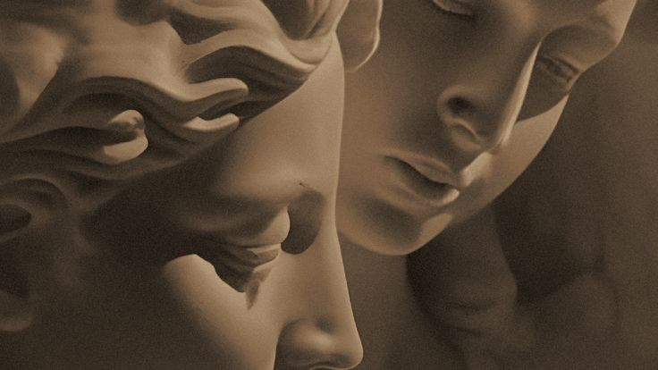

# Reflective Journal

## September 16, 2026

This was my first time getting close to this kind of work, and it genuinely surprised me that I was able to create an actual website, even a simple one. It made me realize how much I'd like to keep learning about this world of web development and coding in general.

Working with Markdown for this project turned out to be more complex than I expected. Even though it looks simple at first, I quickly realized that small mistakes like a missing symbol or an incorrect file can affect the entire page. Because of this, I had to constantly double check what I was writing to make sure everything displayed correctly. What I found cool, though, is that once you understand the small set of rules, you can build something functional very quickly, without needing to write actual code.

What was most difficult for me was making sure every element connected properly, such as the image paths right, linking files to each other, and understanding the difference between files and folders when organizing my project. 

Looking forward, my goal is to create a much more elaborated website in the future, one that reflects my own personal style rather than just following a template. I hope that anyone who visits my page later on can sense that effort and intention behind it. My aspiration is to feel comfortable writing Markdown, understanding each element instead of just copying structures, so I can build my future projects with more confidence and creativity.

## September 23, 2026

This week I had to create three drawings for my prototypes assignment. The first one was an animal face, I thought it wouldn't be too complicated, but it actually was. The part I struggled with the most was positioning the triangles for the ears. It took a lot of trial and error until I got them where I wanted. The abstract drawing had a similar problem with triangles, but I managed to solve it faster this time. What I liked the most about this one was the water reflection I made, it was tricky to get the line positioning right, but I feel like it turned out to be a nice detail.

The last drawing, the weird one, was the most difficult one because I honestly didn't know what to do at first. I started looking through the p5 ideas, and that's when I decided to type random. I found the random() function and I really liked it so I wanted to use it, but it was a bit complex to adapt because the example only showed one shape moving, while I wanted to use several at once. In the end, I managed to get the effect working, and I was happy with the result.

## September 30, 2026

Working with variables, using only the techniques we learned in class, has been one of the slowest but most interesting things we've done so far. It feels like it's more about logic than anything else, and the possibilities depend entirely on you.

What surprised me, and also challenged me, was controlling time in my projects. In my sad circle, it was very hard to make it wait a few seconds before the face started turning blue. It took many tests and errors, but once I figured it out, I was able to apply the same idea in a different way in my flowers, where each one starts growing at its own moment. Of my three projects, the one I enjoyed making the most was definitely the flowers. It took the longest because of how many objects I had to manage, but I liked it the most because of the result. I though, my favorite was the eye that follows the cursor, and in the future I would like to explore that concept further.

## October 07, 2026
This time I worked with conditionals. To be honest, it was a bit hard for me to understand how they worked in class, but doing this assignment made certain things much clearer to me. I liked how varied conditionals can be. For example, in my falling stars it feels like a small game, and I really enjoyed creating it. A star falls, and depending on whether you touch it in time, it shines or goes out and the sky gets darker. What I found difficult was writing so much code. There were moments when I got lost and had to read everything again to remember where I was. Here I felt it was crucial to name everything clearly, because otherwise it became impossible to keep organized.

## October 21, 2026
I really enjoyed working with events. Of all the topics we have seen in class, this is my favorite so far, mostly because it is the one I have understood the best. I also like how organized my scripts are in this assignment. In previous assignments my code felt chaotic because of how many variables I was using, but with events everything feels more orderly.I made three prototypes: Eyes Watching You (mouse), Plant Growing (time) and The Candle (mouse wheel). What I like most is how different kinds of tools fit together: the keyboard, the clicks and the mouse wheel each create a different kind of experience. It also opens the possibility of adding text and more interaction in the future.

Some parts were difficult. A few mistakes did not show up in Visual Studio Code, only in the console when I inspected the page in the browser. I learned that even a single spelling mistake can stop the whole program from running. In my eyes project, I also had a problem where the pupils were not showing up. The code that drew them was outside of the else block, so it ran at the wrong time. I was stuck on it for a long time until I finally found the problem and fixed it. I would like to develop the candle further, maybe by adding text or more interaction on a future.

## October 29,2026
For this assignment we had to work with functions. At first, functions were quite hard to understand, so in my first two exercises, fish tank and cornucopia, I was mostly interpreting the challenge we did in class rather than really understanding it. When the topic was explained again in the next class, it became much clearer, and I was able to make my last exercise, field of flowers, with a much better understanding. What surprised me the most was how, by using functions, I can “draw” many different objects much faster. In the fish tank, for example, I wrote moveFish and drawFish only once, and I could use them with four different fish just by changing what I pass in.

The most difficult part to understand was the names inside the parentheses of a function, like in function moveFish(fish). The extra explanation helped me understand that these names are only a way to refer to the variables that will be affected when the function is called. My favorite exercise was field of flowers, because I could not only use functions but also add something I learned about arrays, like a list of colors that the program picks from randomly, so the field changes every time the page is refreshed. I also liked adding a title with text, which made it feel more finished.In the future, I would like to develop the fruit basket further by adding points and different kinds of fruit or maybe by having a nicer design for the basket.

